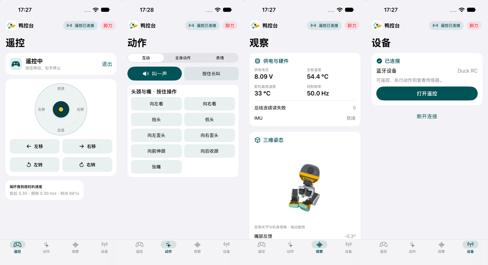
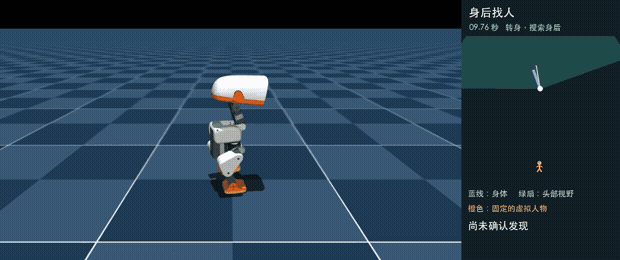

# DuckUp: Microduck Upgrade Station

DuckUp is a software upgrade kit for an assembled, calibrated Microduck. Bring your existing servo calibration, try actions on your duck, or use the checkpoints and training guides to develop your own.

- **Control upgrade · Dozens of actions by name.** Steer with the iPhone joystick, then tap for a left-foot kick, a forward roll, a head tilt or a quack. Take the controls to the duck without a laptop or a list of gamepad shortcuts. Open the observation tab for live video and joint angles. [iPhone controller](https://github.com/chris-embodied/duckup-control)
- **Training upgrade · Start with a duck that can walk or sit.** Adapt VelStand s54 for gait or SitStand s111 for posture transitions. Both checkpoints have run on hardware. Training and export checks are documented; public weight downloads are pending. [Models and training](https://github.com/chris-embodied/duckup-models)
- **Interaction upgrade · Let the duck find you.** Call from behind and watch the duck look both ways, turn and face you. Try the animation in your browser. [Play Find Me](examples/find-me/README.md)
- **Research preview · One GPU, multiple skills.** We are reproducing SuperMimic on Microduck, using a world model and one RTX 5090 to train a single policy from scratch and test which skills transfer to hardware. [Experiment notes](docs/supermimic.md)

We built our duck using these guides for parts, assembly and calibration. [microduck-replica](https://github.com/fanhao375/microduck-replica) · [Microduck-kissqy](https://kissqy.github.io/Microduck-kissqy/build/start.html)

[Install DuckUp with your existing calibration](docs/start.md) · [All interactions](examples/README.md) · [中文](README.md)

**Install on a calibrated duck with one microSD or two.** Reflashing erases the entire target card. Before reusing your only card, export its active calibration to your Mac, save any other files you need, and make a verified full-card image if you want to restore your current system exactly. With a spare card, keep the original for rollback. Flash the motion image to your chosen card, then select your calibration and enter your Wi-Fi in the Mac setup assistant. In the iPhone app, select the Bluetooth device **Duck Base** and connect with observation code `000000`, then scan the owner QR on your Mac once to enable remote control. You can also import the key from Files. The local candidate includes the V260 HD1910 runtime and movement policies. The migration and control protocol have been tested offline. A fresh-card hardware boot is pending. The app currently installs through Xcode signing.

**Try an interaction without a robot.** Download this repository and open `examples/find-me/index.html` in a browser. Pick a spot behind the duck and trigger a call. Scrub the timeline to see when the duck first sees you and when its body faces you. The browser replays a 2D state machine. The clip below is a separate physics simulation with a frozen walk policy and a virtual person.

**Train a new behavior.** VelStand s54 handles walking and turning. SitStand s111 handles sitting down and getting back up. Each candidate pack includes actor and critic weights, normalization and optimizer state, an inference export, and training configuration. The CPU check compares PyTorch and ONNX outputs and verifies gradients. Reproducing a full RL update also requires the compatible HD1910 environment. [Training steps](https://github.com/chris-embodied/duckup-models/blob/main/training/README.md)

**Help shape the next game.** Voice conversations, passing a ball to a person, and a turn-around chase game are at different stages of prototyping. Which would you play first? [Share a reproducible scenario](CONTRIBUTING.md).
