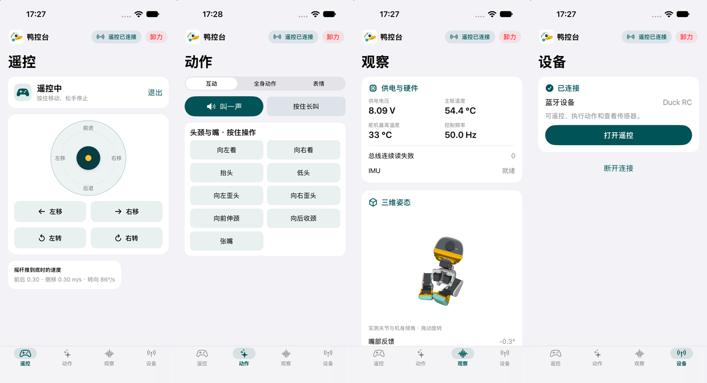
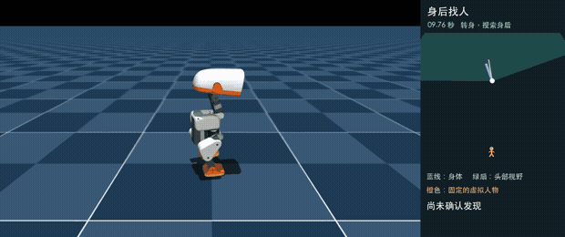

# DuckUp: Microduck 升级站

DuckUp 是给已组装、已标定的 Microduck 用的软件升级套件。保留原来的舵机标定，接上鸭控台，就能在真鸭上试动作；想开发新动作，也有配套的模型和训练步骤。

- **操控升级 · 几十个动作，点名就能做。** 拿起 iPhone，摇杆管走路和转向，按钮管左右脚踢球、前滚翻、歪头和叫声。比手柄少记组合键，比电脑网页方便带到鸭子旁边；切到观察页就能看实时画面和关节角度。[鸭控台](https://github.com/chris-embodied/duckup-control)
- **训练升级 · 从会走、会坐的模型接着练。** 改步态用 VelStand s54，改坐下起身用 SitStand s111。两份 checkpoint 都有真机使用记录，配套续训步骤与部署校验，权重待开放下载。[模型与续训](https://github.com/chris-embodied/duckup-models)
- **玩法升级 · 让鸭子来找你。** 在它背后叫一声，看它先左右张望，再转身正对你。现在就能在浏览器里试玩动画。[试玩「鸭子找你」](examples/find-me/README.md)
- **研究预告 · 一张显卡训练多种动作。** 在 Microduck 上复现 SuperMimic，用世界模型和单张 RTX 5090 从零训练同一个策略，检验它能在真机上完成哪些动作。[复现实验](docs/supermimic.md)

我们的硬件复刻参考了这两个项目，选件、装配和标定可跟随它们的教程。[microduck-replica](https://github.com/fanhao375/microduck-replica) · [Microduck-kissqy](https://kissqy.github.io/Microduck-kissqy/build/start.html)

[已标定？保留标定安装 DuckUp](docs/start.md) · [全部玩法](examples/README.md) · [English](README.en.md)

**适配组合**　Radxa ZERO 3W · 飞特 HD1910 × 15 · 兼容的 HAT / IMU / HUB · iPhone（iOS 17+）。上图来自开发版 App，三维外观资源单独管理。[素材说明](THIRD_PARTY.md)

### 已经有一只调好的鸭子？

1. **留住已经调好的零位。** 在 Mac 打开安装助手，导出这只鸭子正在使用的标定。已有备份可直接选用。
2. **一张 microSD 就能装。** 重刷原卡会清空整张卡。先把标定和要保留的文件备份到 Mac；想原样恢复旧系统，再做一份整卡镜像。如果有备用卡，也可以刷备用卡、留好原卡。刷好后选标定、填 Wi-Fi，两种方式后续相同。
3. **连接并接管。** iPhone 在「设备」选择蓝牙设备 **Duck Base**，输入 `000000` 即可观察。用鸭控台扫一次 Mac 显示的机主二维码，即可试 HOME、卸力和走路。下次连接会记住这只鸭。

本地候选镜像适配 V260 飞特驱动。开发实机此前已验证遥控；标定迁移与遥控授权已做离线验收，成品镜像的真机首启仍待验证。鸭控台目前通过 Xcode 签名安装。

[安装步骤与故障定位 →](docs/start.md)

### 在它背后叫它，它会怎么找你？

鸭子先左右看。视野里没有人，它会停一下、转过身；找到目标后让身体也朝向对方。在下面这次物理仿真中，目标起初在正后方 1.5 米，右边的小图显示头部视野。四个测试环境都完成了对正和末段站稳。

**你也可以换个位置试。** 离线演示可选正后方、左侧、正前方或空场，拖动时间轴就能看出「看见」和「对正」差了多久。浏览器按钮代替呼唤，演示与真机遥控相互独立。[打开方式和玩法源码 →](examples/find-me/README.md)

### 想让它学一个新动作？

| 从哪个模型出发 | 它已经会什么 | 适合接着研究什么 |
| --- | --- | --- |
| **VelStand s54** | 站稳、走路和转向 | 跟随人的方向、改变步态、转身后停稳 |
| **SitStand s111** | 坐下、起身，起身后交还行走控制 | 坐姿互动、起身时的姿态过渡 |

每份本地候选训练包都保留 PyTorch checkpoint、对应 ONNX 和训练配置。仓库提供校验与加载代码，记录训练和实机导出之间的数值对照；权重下载和匹配的训练环境随发布进度开放。[查看模型卡](https://github.com/chris-embodied/duckup-models/blob/main/models/README.md) · [继续训练的步骤](https://github.com/chris-embodied/duckup-models/blob/main/training/README.md)

### 正在做哪些互动？

[进入玩法主页](examples/README.md)

| 玩法 | 进展 |
| --- | --- |
| 手机遥控、表情和叫声 | 开发实机可用，按设备上报能力显示动作 |
| 叫它、找人、对正后聊天 | Mac 有唤醒与对话原型，身后找人已做仿真；ZERO 3W 整机联调待做 |
| 找球、朝接球人踢 | 已用视觉和实际脚球接触做仿真；实物球测试待做 |
| 回头抓鸭子 | 玩法设计阶段 |

有想让小鸭学会的互动？描述一个能观察到的结果，例如「我藏到身后，它找不到我时应当停下来」。[参与玩法和复刻测试 →](CONTRIBUTING.md)

感谢 Radxa、Pollen Robotics、kissqy 和各上游贡献者。DuckUp 提供系统集成、鸭控台和互动开发入口。[依赖与许可范围](THIRD_PARTY.md)
